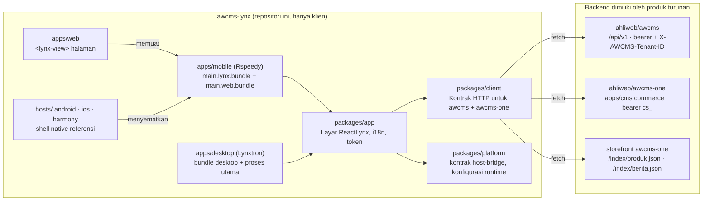

🇮🇩 Bahasa Indonesia · 🇬🇧 [English (sumber)](architecture.md)

# Arsitektur

Bagaimana satu basis kode ReactLynx menjangkau lima host dan dua backend, serta bagian mana yang memiliki tanggung jawab atas apa.

## Gambaran umum

Tidak ada server di repositori ini. Setiap panah yang menuju "Backend" adalah panggilan HTTP ke sebuah instans yang di-deploy dan dimiliki oleh produk turunan ([ADR-0001](adr/0001-awcms-lynx-is-the-persona-app-template-repository.md) D2).

## Lapisan

| Lapisan | Paket | Berjalan di | Bergantung pada | Tidak boleh |
| --- | --- | --- | --- | --- |
| UI | `@awcms-lynx/app` | Thread utama Lynx (render) + background thread (efek, event) | client, platform, `@lynx-js/react` | memanggil `fetch` secara langsung; membaca `NativeModules`; menyimpan token di state komponen lebih lama dari satu render |
| API | `@awcms-lynx/client` | Background thread Lynx, peramban, pengujian Bun | tidak ada | menggunakan `URL`, `URLSearchParams`, `crypto`, `Intl`, `Buffer`, API DOM atau Node ([`lynx-runtime.md`](lynx-runtime.md)) |
| Kontrak host | `@awcms-lynx/platform` | background thread (`bridge.ts`, `runtime-config.ts`); halaman peramban (`web-host.ts`) | tidak ada | menambah metode tanpa menaikkan `HOST_BRIDGE_VERSION` ([ADR-0003](adr/0003-one-host-bridge-contract-for-every-lynx-host.md)) |
| Bundle | `apps/mobile`, `apps/desktop` | waktu build | app, toolchain Lynx | berisi kode UI sendiri |
| Host | `apps/web`, proses utama `apps/desktop`, `hosts/*` | platform | kontrak | mempercayai input bundle tanpa memvalidasinya |

## Dua thread Lynx, dalam aplikasi ini

ReactLynx merender di **thread utama** dan menjalankan efek, handler event, serta `fetch` di **background thread** (kode `'background only'`). Karena itu, semua yang ada di `packages/client` dan `packages/platform/src/bridge.ts` berjalan di background thread, tempat Lynx menyediakan `fetch`, timer, `TextEncoder`, `console`, dan `NativeModules` — dan tidak ada hal lain dari platform Web. Pada host Web, background thread adalah Web Worker; itulah sebabnya penyimpanan dilakukan melalui host bridge, bukan `localStorage`.

## Urutan boot

1. Host memuat bundle dan meneruskan `globalProps` (penimpaan opsional).
2. `startApp(BUILD_DEFAULTS)` (`packages/app/src/start.tsx`) menentukan `RuntimeConfig` dengan menggabungkan `PUBLIC_AWCMS_*` saat build dan `globalProps`, lalu memvalidasinya. Konfigurasi yang tidak valid menampilkan `ConfigErrorScreen` alih-alih membuat aplikasi crash.
3. `createHostBridge()` memilih transport: modul native `AwcmsHostBridge` → `bridge` bawaan (Web, Lynxtron) → memori.
4. `AwcmsApp` membuat klien di atas penyimpanan aman milik bridge, lalu secara paralel membaca `app.info`, preferensi bahasa yang tersimpan, dan sesi yang tersimpan.
5. Tab untuk backend yang dikonfigurasi dirender. Perubahan sesi (masuk, keluar, `401`) dirender ulang melalui `SessionManager.subscribe`.

## Routing

Aplikasi tidak memiliki router URL: satu tab bar (`Home`, `Search` atau `Catalog`, `Account`, `Settings`) dan langkah-langkah di dalam layar (masuk → workspace → MFA). Ini menjaga versi pertama bebas dari dependensi navigasi yang harus dibuktikan berjalan di lima host. Deep link merupakan langkah berikutnya yang sudah didokumentasikan: ia memerlukan kontrak metode (`link.initial` / sebuah event) dan pendaftaran URL per platform (`hosts/README.md`).

## Data yang disimpan klien

Tidak ada database di repositori ini. Satu-satunya rekaman yang disimpan, keduanya melalui `secureStorage`:

| Kunci | Nilai | Ditulis oleh | Dihapus saat |
| --- | --- | --- | --- |
| `awcms-lynx:session` | JSON `StaffSession` `{kind:'staff', token, expiresAt, tenantId, assuranceLevel}` atau `CustomerSession` `{kind:'customer', token, expiresAt, account}` | `login`/`selectTenant`/`verifyTotp`, `verifyOtp` | keluar, `401` untuk token tersebut, `expiresAt` staf sudah lewat, JSON tidak dapat dibaca |
| `awcms-lynx:pref:locale` | `id` atau `en` | Pengaturan | tidak pernah (preferensi) |

Data sisi server — tenant, pengguna, peran, konten, produk, pesanan, audit log — berada di PostgreSQL milik backend di bawah row-level security; lihat dokumentasi skema milik repositori backend. Aplikasi tidak pernah men-cache data tersebut lebih lama dari masa hidup sebuah layar.

## Lokasi setiap tanggung jawab

| Tanggung jawab | Di sini | Di backend |
| --- | --- | --- |
| Autentikasi | layar masuk, penyimpanan sesi | menerbitkan, memverifikasi, dan mencabut token |
| Otorisasi | menampilkan peran dari `GET /auth/session`; tidak menyembunyikan apa pun demi keamanan | memutuskan semuanya: RBAC + ABAC, default deny, RLS |
| Audit logging | mengirim `X-Correlation-ID` pada setiap permintaan agar entri audit server dapat ditelusuri ke panggilan klien | menulis audit log |
| Konten, taksonomi, publikasi | membaca konten yang sudah dipublikasikan (feed, pencarian, indeks storefront) | alur editorial di admin Astro |
| Media | merender URL gambar yang dikembalikan API | unggah, penyimpanan (R2), visibilitas |
| Branding / logo | `appName`, token di `app.css`, ikon host | profil situs, manajemen logo di admin |
| Periklanan | tidak ada | penempatan iklan `news_portal` (hanya API terautentikasi) |
| SEO | tidak berlaku untuk aplikasi persona; host web berstatus `noindex` | situs publik tetap di Astro (ADR-0146) |
