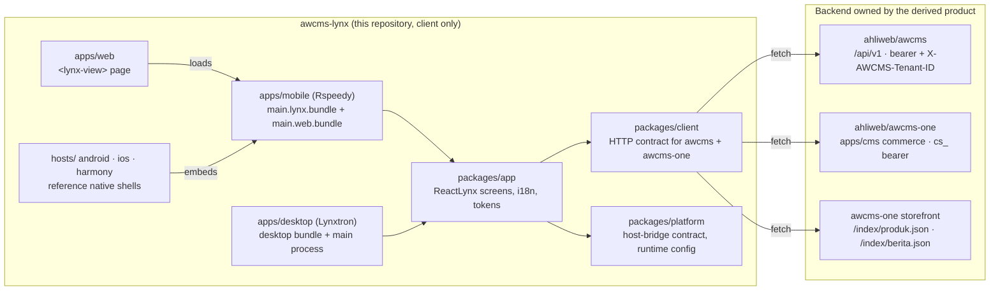

# Architecture

How one ReactLynx code base reaches five hosts and two backends, and which piece owns what.

## The picture

There is no server in this repository. Every arrow into "Backend" is an HTTP call to an instance the derived product deploys and owns ([ADR-0001](adr/0001-awcms-lynx-is-the-persona-app-template-repository.md) D2).

## Layers

| Layer | Package | Runs in | Depends on | Must not |
| --- | --- | --- | --- | --- |
| UI | `@awcms-lynx/app` | Lynx main thread (render) + background thread (effects, events) | client, platform, `@lynx-js/react` | call `fetch` directly; read `NativeModules`; hold a token in component state longer than a render |
| API | `@awcms-lynx/client` | Lynx background thread, browser, Bun tests | nothing | use `URL`, `URLSearchParams`, `crypto`, `Intl`, `Buffer`, DOM or Node APIs ([`lynx-runtime.md`](lynx-runtime.md)) |
| Host contract | `@awcms-lynx/platform` | background thread (`bridge.ts`, `runtime-config.ts`); browser page (`web-host.ts`) | nothing | grow a method without bumping `HOST_BRIDGE_VERSION` ([ADR-0003](adr/0003-one-host-bridge-contract-for-every-lynx-host.md)) |
| Bundles | `apps/mobile`, `apps/desktop` | build time | app, Lynx toolchain | contain UI code of their own |
| Hosts | `apps/web`, `apps/desktop` main process, `hosts/*` | the platform | contract | trust the bundle's input without validating it |

## Lynx's two threads, in this app

ReactLynx renders on the **main thread** and runs effects, event handlers and `fetch` on the **background thread** (`'background only'` code). Everything in `packages/client` and `packages/platform/src/bridge.ts` therefore runs on the background thread, where Lynx provides `fetch`, timers, `TextEncoder`, `console` and `NativeModules` — and nothing else from the Web platform. On the Web host, the background thread is a Web Worker: that is why storage goes through the host bridge instead of `localStorage`.

## Boot sequence

1. The host loads the bundle and passes `globalProps` (optional overrides).
2. `startApp(BUILD_DEFAULTS)` (`packages/app/src/start.tsx`) resolves `RuntimeConfig` = build-time `PUBLIC_AWCMS_*` overlaid with `globalProps`, and validates it. An invalid config renders `ConfigErrorScreen` instead of crashing.
3. `createHostBridge()` picks the transport: `AwcmsHostBridge` native module → built-in `bridge` (Web, Lynxtron) → memory.
4. `AwcmsApp` creates the client over the bridge's secure storage, then in parallel reads `app.info`, the stored locale preference and the stored session.
5. Tabs for the configured backend render. Session changes (sign-in, sign-out, a `401`) re-render through `SessionManager.subscribe`.

## Routing

The app has no URL router: one tab bar (`Home`, `Search` or `Catalog`, `Account`, `Settings`) and in-screen steps (sign-in → workspace → MFA). This keeps the first version free of a navigation dependency that would have to be proven on five hosts. Deep links are a documented next step: they need a contract method (`link.initial` / an event) and per-platform URL registration (`hosts/README.md`).

## Data the client keeps

There is no database in this repository. The only persisted records, both through `secureStorage`:

| Key | Value | Written by | Cleared when |
| --- | --- | --- | --- |
| `awcms-lynx:session` | JSON `StaffSession` `{kind:'staff', token, expiresAt, tenantId, assuranceLevel}` or `CustomerSession` `{kind:'customer', token, expiresAt, account}` | `login`/`selectTenant`/`verifyTotp`, `verifyOtp` | sign-out, a `401` for that token, staff `expiresAt` passed, unreadable JSON |
| `awcms-lynx:pref:locale` | `id` or `en` | Settings | never (preference) |

Server-side data — tenants, users, roles, content, products, orders, audit logs — lives in the backend's PostgreSQL under row-level security; see the backend repositories' own schema documentation. The app never caches it beyond the life of a screen.

## Where each concern lives

| Concern | Here | In the backend |
| --- | --- | --- |
| Authentication | sign-in screens, session storage | issues, verifies and revokes tokens |
| Authorization | shows roles from `GET /auth/session`; hides nothing for security | decides everything: RBAC + ABAC, default deny, RLS |
| Audit logging | sends `X-Correlation-ID` on every request so server audit entries can be traced to a client call | writes the audit log |
| Content, taxonomy, publishing | reads published content (feed, search, storefront index) | editorial workflow in the Astro admin |
| Media | renders image URLs the API returns | upload, storage (R2), visibility |
| Branding / logo | `appName`, tokens in `app.css`, host icons | site profile, logo management in the admin |
| Advertising | none | `news_portal` ad placements (authenticated API only) |
| SEO | not applicable to a persona app; the web host is `noindex` | public sites stay Astro (ADR-0146) |
